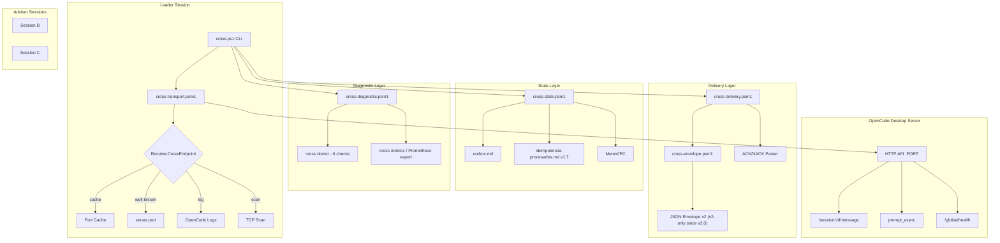

# OpenCode Cross-Talk

[](https://github.com/davidlopezsalvador/opencode-crosstalk/actions/workflows/test.yml)

[User Guide for Non-Coders](USER_GUIDE.md) | [Protocol spec](CROSS_TALK.md) | [Changelog](CHANGELOG.md) | [Windows pitfalls](CROSS_WINDOWS.md)
> **Are you an LLM agent?** Read [`AGENTS.md`](AGENTS.md) - it bootstraps you into
> the protocol in ~3 minutes (identify yourself -> connect -> send/receive tasks,
> with ACK and signing conventions). Curated doc index: [`llms.txt`](llms.txt).


## What it does

OpenCode Desktop runs a local HTTP server (`http://127.0.0.1:PORT`) that exposes each chat session. CROSS-TALK builds on top of that to enable:

- **Inter-session messaging** — send messages between any two sessions in the same project
- **Durable outbox** — messages survive crashes; tracked in `outbox.md`
- **ACK/NACK handshakes** — sender knows if the recipient processed the message
- **Idempotent delivery** — at-least-once with deduplication via `idempotencia-procesados.md`
- **Automatic retries** — configurable backoff, lease renewal, and circuit breakers
- **Diagnostics** — classify failures (provider down, agent sleeping, config error) from OpenCode logs
- **Dead letter queue** — messages that can't be delivered after max retries go to DLQ for human review
- **AVISO-SPOF** — passive detection if the leader session goes silent

## Quick start

### Prerequisites

- PowerShell 5.1+ (Windows) or PowerShell 7+ (Windows / Linux / macOS / WSL)
- [OpenCode Desktop](https://opencode.ai) running with at least 2 open sessions
- `curl` (built into Windows 10+; standard on Unix)

> **Platform support:** Windows is the primary, fully-tested platform. Linux /
> macOS / WSL work through the cross-platform layer in `cross-ipc.psm1`
> (named mutex on Windows; advisory file lock on Unix — exclusive in
> practice, not a POSIX `flock()`). The test suite runs server-independent
> suites on CI (`windows-latest`); Unix is supported but less battle-tested.

### Setup

1. Clone this repo
2. Run the setup helper. It validates your session via the API, derives the
   model from the API (never guesses), writes the git-ignored
   `cross/cross.config.local.json` and verifies `health`/`whoami`:

```powershell
powershell -NoProfile -ExecutionPolicy Bypass -File install.ps1
# If it reports ambiguity (exit 2), choose explicitly:
powershell -NoProfile -ExecutionPolicy Bypass -File install.ps1 -SessionId ses_YOUR_ID
```

3. Or configure manually — write ONLY `cross/cross.config.local.json` (never edit
   the publish template `cross.config.json`, which would commit your identity):

```json
{
    "my_session_id": "ses_YOUR_SESSION_ID",
    "my_role": "advisor"
}
```

`my_model` is optional: `whoami` derives it from the API and reports
`model_source` (`config` / `override` / `api`). Several agents sharing one clone
should use `CROSS_MY_MY_SESSION_ID` / `CROSS_MY_MY_MODEL` env overrides instead.

4. Run the CLI:

```powershell
cd cross
.\cross.ps1 health          # verify server is reachable
.\cross.ps1 sessions         # list active sessions
.\cross.ps1 send --msg test --dest ses_DEST --text "Hello from CROSS-TALK"
```

### Usage

```
cross health                    # verify server connection
cross whoami                    # show current session info
cross sessions                  # list all sessions in the project
cross read --session ses_X      # read messages from a session
cross config --list             # show current configuration

cross send --msg MSG_ID --dest ses_Y --token T --text "..."  # send (outbox auto-created)
cross ack --token T --for-msg-id X --to ses_SENDER          # v2 JSON ACK to the sender
cross nack --token T --for-msg-id X --reason REASON --to ses_SENDER  # reject with reason

cross status                    # overview of outbox + idempotency + DLQ
cross scan                      # check for expired leases
cross diagnose --msg MSG_ID     # classify why a message failed
cross metrics                   # delivery statistics
```

See `cross.ps1 --help` for the full list of 20+ subcommands.

## Example: 3-session handshake in under a minute

With 3 sessions open (A = you, B = advisor, C = advisor):

```powershell
# 1. Verify connectivity
.\cross.ps1 health                       # ok: true

# 2. Send a task to session B (writes outbox, wakes B via prompt_async)
.\cross.ps1 send --msg t1 --dest ses_B --token T1 --text "Analyze the poll results and reply"
# -> outbox.md: [ts] OUTBOX | t1 | dest=ses_B | ESTADO=EN_VUELO

# 3. B acknowledges FIRST with the v2 JSON envelope, then works
#    (B runs, from cross/: .\cross.ps1 ack --token T1 --for-msg-id t1 --to ses_A)
#    The sender polls and classifies the outcome:
.\cross.ps1 status
# -> t1 CONFIRMADO (v2 ack envelope from ses_B received)

# 4. B fails to answer in time -> diagnose why, then retry or escalate
.\cross.ps1 diagnose --msg t1             # provider down / agent sleeping / config error
.\cross.ps1 scan                          # expired leases
```

That is the whole loop: outbox -> prompt_async -> ACK/NACK -> retry or DLQ. The
anti-sleep protocol (`ESTADO:` heartbeats, AVISO-SPOF) keeps long-running
teams alive — see [CROSS_TALK.md](CROSS_TALK.md) sections 4 and 12.

## Project structure

```
cross-talk/
├── CROSS_TALK.md              # Protocol specification (wire format: envelope v2)
├── AGENTS.md                  # LLM bootstrap (read me first)
├── QUICKSTART.md              # 3-minute human quick start
├── USER_GUIDE.md              # Non-coder guide (Director/Leader/Advisors)
├── llms.txt                   # Curated doc index for LLM agents
├── CHANGELOG.md               # Version history and discoveries
├── CROSS_WINDOWS.md           # PowerShell 5.1 / Windows pitfalls
├── install.ps1                # One-command setup (API-validated identity + model)
├── LICENSE                    # MIT
├── README.md                  # This file
└── cross/
    ├── cross.ps1              # CLI entry point (20+ subcommands)
    ├── cross.config.json      # Publish template (empty identity)
    ├── cross.config.local.json# Your identity (git-ignored, created by install.ps1)
    ├── lib/
    │   └── cross-format.psm1  # Formatting utilities
    ├── modules/
    │   ├── cross-transport.psm1   # HTTP transport, port detection, netrc, config
    │   ├── cross-state.psm1       # Outbox, idempotency (checksums v1.7), mutex
    │   ├── cross-delivery.psm1    # ACK/NACK parsing, retries, leases
    │   ├── cross-envelope.psm1    # JSON envelope v2 (v2-only since v2.0)
    │   ├── cross-diagnostic.psm1  # Status, metrics, doctor, Prometheus export
    │   └── cross-action.psm1      # ack, nack, resume, restart, etc.
    └── tests/                 # 34 test suites (7100+ assertions)
        ├── T-ack.ps1
        ├── T-nack.ps1
        ├── T-send.ps1
        ├── T-fuzz.ps1
        └── ... (33 files)
```

## How it works

1. **Autodetect credentials** — port and password are read from OpenCode logs before every send (they change on restart)
2. **Write to outbox** — message is recorded in `outbox.md` with state `EN_VUELO`
3. **Send via HTTP** — `prompt_async` wakes the target agent
4. **Wait for ACK** — sender polls for acknowledgment (configurable timeout)
5. **Classify result** — ACK → `CONFIRMADO`, NACK → reason logged, timeout → diagnostic from logs
6. **Retry or DLQ** — on failure, retry with backoff; after max retries, move to dead letter queue

The full protocol rules are in [CROSS_TALK.md](CROSS_TALK.md) (section 4 for messaging, section 12 for the anti-sleep protocol).

## Arquitectura (v2.1.1)



## Running tests

```powershell
cd cross\tests
# Run all tests
Get-ChildItem T-*.ps1 | ForEach-Object { powershell -NoProfile -ExecutionPolicy Bypass -File $_.FullName }

# Run a specific test
powershell -NoProfile -ExecutionPolicy Bypass -File T-send.ps1
```

## Troubleshooting

| Symptom | Cause | Fix |
|--|--|--|
| `NO_IDENTITY` | No local config nor env overrides | Run `install.ps1`, or pass `--session-id/--model`, or set `CROSS_MY_MY_SESSION_ID` |
| `OUTBOX_MSG_NOT_FOUND` | (pre-v2.1.1) CLI run outside `cross/`: relative `whiteboard_dir` pointed to the wrong folder | Upgrade (paths resolve against the config file) or run from `cross/`. With `--dest`+`--text` the entry is now auto-created |
| ACK sent but sender never sees it | Plain-text ACK, wrong recipient, or no token | Use `.\cross.ps1 ack --token T --for-msg-id X --to <sender_session>`; only `ENVELOPE-V2: {json}` / pure JSON is parsed |
| `whoami` shows empty model | `my_model` missing from config | v2.1.1 derives it from the API (`model_source=api`); otherwise pass `--model` |
| `AUTH_FAILED` | Stale password in `.env` vs live env var | `OPENCODE_SERVER_PASSWORD` (env) wins; `cross health` reports `password_source` |
| `ACK_TIMEOUT` | Destination busy/asleep | `cross nudge --to <id>`; `--ack-timeout 0` for fire-and-forget |
| `install.ps1` exits 2 | Identity ambiguous (no/several candidates) | Re-run with `-SessionId ses_...` (it never picks `sessions[0]`) |
| Two agents share one clone | Same local config for both | Give each one `CROSS_MY_MY_SESSION_ID` / `CROSS_MY_MY_MODEL` |
| Local tests fail in T-ack/T-transport | A runtime `cross.config.local.json` overrides the template identity those suites assume | Move the sidecar aside (CI runs with the template) |

If a session appears frozen after a provider error, check `cross diagnose --msg X`
and the OpenCode logs; the anti-sleep protocol (`sigue`/RESUME) is described in
`CROSS_TALK.md` section 12.

## License

[MIT](LICENSE)
